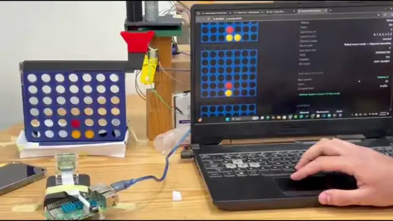
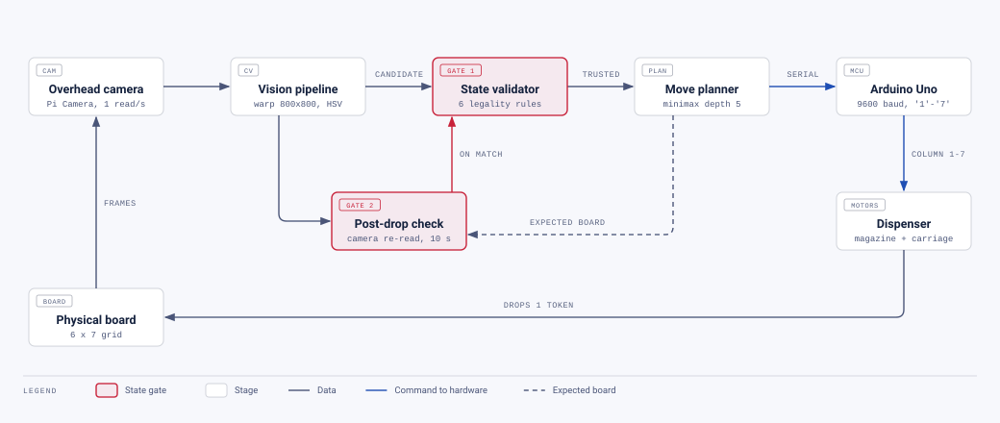
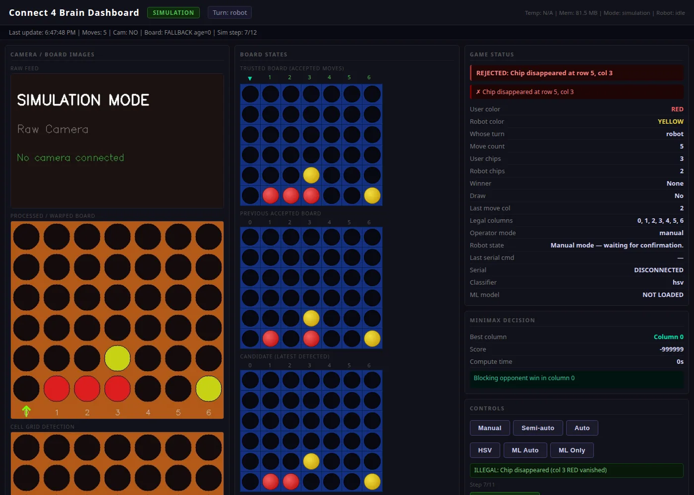
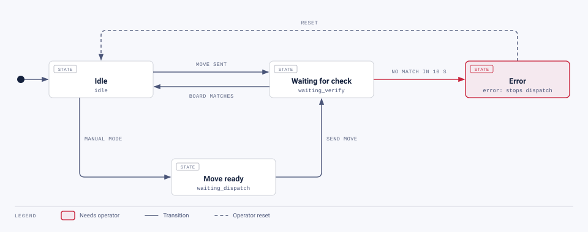

# Vision-Based Connect-4 Robot

A Raspberry Pi robot that plays Connect-4 against a person. It reads the board with a camera, refuses boards that cannot happen in a real game, picks its move with minimax, drops a token with an Arduino-driven dispenser, and then checks with the camera that the token really landed.

[](https://github.com/andrew-abdelmalak/connect-4-robot/actions/workflows/ci.yml)
[](https://github.com/andrew-abdelmalak/connect-4-robot/actions/workflows/paper.yml)
[](LICENSE)

[](https://andrew-abdelmalak.github.io/connect-4-robot/#watch)

We built it as a team of six for MCTR 1010, Image Processing for Mechatronics, at the German University in Cairo (Spring 2026). Read the [paper (PDF)](docs/Vision-Based-Connect-4-Robot.pdf) for the full write-up.

**[Play against the robot's real code in your browser](https://andrew-abdelmalak.github.io/connect-4-robot/)**: the project page runs the same vision, validator, and planner Python with Pyodide, and the compiled Arduino sketch on an emulated Uno with avr8js.

## What makes it work

A camera can misread a frame, and a dispenser can miss a column. This robot assumes both will happen and checks them at two gates:

1. **Before it thinks.** A new board from the camera only counts if it is exactly one legal move away from the last accepted board. A chip that vanished, two new chips at once, or a chip floating above an empty cell: the robot rejects it and keeps the last good board.
2. **After it moves.** When the robot drops a token, it already knows what the board should look like. It accepts its own move only when the camera shows that exact board within 10 seconds. A token that slid into the wrong column stops the robot with an error instead of silently corrupting the game.

<picture>
  <source media="(prefers-color-scheme: dark)" srcset="docs/diagrams/closed-loop-dark.svg">
  
</picture>

## Results

From the final course report (MS4/5) and the paper, measured on the real robot under indoor lighting with a fixed camera mount:

| Measure | Result |
|---|---|
| Cells read correctly, HSV colour thresholds | 98% (about 200 labelled cell images) |
| Cells read correctly, hybrid HSV + machine learning | 96% |
| Cells read correctly, machine learning only (RandomForest) | 91% |
| Tokens that landed in the commanded column | 95% of 140 drops (20 per column) |
| Columns 1 to 3 / column 7 | 100% / 85% |
| Time from command to verified move | 3 to 15 s, 7.5 s on average |

Two findings stand out. The plain HSV thresholds beat the learned model, because the board is blue and the tokens are red and yellow under steady light, while the model had little training data. The weak point was the mechanism: misses grow with carriage travel toward the far columns, because the carriage is positioned by timing, not by an encoder.

> [!NOTE]
> We did not keep the labelled cell images and the drop logs behind these numbers, so they cannot be re-run from this repository. The code, the board-reading test on a real photo, and the logic tests can.

## Try it without the robot

Simulation mode runs the real game logic, validator, and planner in the dashboard, stepping through a scripted game that includes illegal boards. It needs no camera, Arduino, or Raspberry Pi.

Requirements: Python 3.11 or later and [uv](https://docs.astral.sh/uv/).

```bash
git clone https://github.com/andrew-abdelmalak/connect-4-robot.git
cd connect-4-robot
uv sync
uv run connect4-robot --sim
```

Open <http://localhost:5000> and press **Next Sim Step**. Each step shows whether the validator accepted the board, and why.



Run the test suite:

```bash
uv run pytest
```

## Run it on the robot

| Part | Command or step |
|---|---|
| Raspberry Pi (camera mode) | `uv run connect4-robot`, then open `http://<pi-address>:5000` from a laptop on the same network |
| Arduino Uno | `arduino-cli compile --fqbn arduino:avr:uno arduino/dispenser`, then upload it, or open `arduino/dispenser/dispenser.ino` in the Arduino IDE |
| Optional ML model | Put cell images in `~/ml_cells/{empty,red,yellow}/`, then `uv run python -m connect4_robot.train_cell_model` |

Options and fixed settings:

| Setting | Default | Where |
|---|---|---|
| `--sim` | off (camera mode) | command line |
| `--port` | `5000` | command line |
| `--depth` | `5` (minimax search depth, 1 or more) | command line |
| Serial port and speed | `/dev/ttyUSB0`, 9600 baud | `SERIAL_PORT`, `SERIAL_BAUD` in `src/connect4_robot/hardware.py` |
| Board corners when detection fails | built-in defaults | optional `~/warp_corners.json` |
| ML model | not loaded | `~/connect4_cell_model.pkl` |

The dashboard has three operator modes. **Manual** waits for you to accept each board and send each robot move. **Semi-auto** accepts clean camera boards on its own. **Auto** also sends the robot's move.

<picture>
  <source media="(prefers-color-scheme: dark)" srcset="docs/diagrams/robot-states-dark.svg">
  
</picture>

## How it reads the board

1. Find the blue board frame by colour, then smooth its four corners over frames.
2. Warp the board to an 800 x 800 top-down view.
3. Brighten (+20), stretch contrast (x1.3), and blur (5 x 5 Gaussian).
4. Cut the view into a 6 x 7 grid and read the centre of each cell as empty, red, or yellow.

The Milestone 2 notebook, [`notebooks/ms2_image_pipeline.ipynb`](notebooks/ms2_image_pipeline.ipynb), shows each image operation on a sample board with timings. CI runs it on every push.

## Limitations

- **Lighting and setup.** All results come from one fixed camera mount and steady indoor light. HSV thresholds drift with glare and other lighting.
- **Board detection assumes a framed view.** Detection takes the largest blue shape as the grid. On the sample photo, where the board's legs are also blue, the grid lines up wrong. With the grid's own corners, the same code reads all 42 cells correctly (see `tests/test_vision.py`).
- **Carriage by timing.** The carriage has no position sensor, so the far columns miss more often. A carriage encoder or limit switch is the most useful upgrade.
- **Small ML dataset.** The machine-learning mode is a secondary option, and its model file is not included.
- **No login on the dashboard.** Anyone on the same network can send moves or reset the game. Run it only on a network you trust.
- **Known issues in the dispenser sketch.** A code review found these. We left the sketch as is, because it is the version that ran in the demo and there is no robot to test a change on:
  - the encoder count is read without pausing interrupts. On the project page's emulated Uno this stops the magazine at 256 of 400 pulses in 9 of 40 test runs (at the page's assumed encoder speed); the same sketch with the read wrapped in `noInterrupts()` reached 400 in 40 of 40;
  - the magazine motor has no timeout if the encoder stops;
  - serial bytes that arrive during a move run as a second command afterwards;
  - opening the serial port can reset the Uno, so the Pi should wait for `READY` before the first command.

## Repository layout

```text
src/connect4_robot/   Python package: board, minimax, validator, simulator, vision, hardware, dashboard
tests/                pytest suite, including a recorded set of minimax answers
arduino/dispenser/    final Arduino sketch (carriage + magazine)
arduino/m1_servo_gate_controller/   Milestone 1 servo prototype
notebooks/            Milestone 1 and 2 image-processing work and the sample board photo
paper/                IEEE-style paper source (LaTeX), same file names as the Overleaf project
docs/                 paper PDF, milestone reports MS1 to MS4/5, presentation, figures, diagrams
```

## Hardware and cost

| Component | Qty | EGP |
|---|---:|---:|
| Raspberry Pi 4 (4 GB) | 1 | 4,250 |
| Arduino Uno | 1 | 450 |
| Pi Camera 5MP Rev 1.3 | 1 | 275 |
| TT geared DC motor (carriage) | 1 | 50 |
| Encoder DC motor (magazine) | 1 | 420 |
| L298N H-bridge driver | 1 | 75 |
| 12 V 1.2 A power supply | 1 | 50 |
| Wires, breadboard, structural parts | - | 530 |
| **Total** | | **6,100** |

That is about 115 USD at the April 2026 rate of roughly 53 EGP per USD. An earlier design used stepper motors and a servo; the final build moved to the cheaper DC-motor carriage and magazine.

## Documents

- [Paper (PDF)](docs/Vision-Based-Connect-4-Robot.pdf) and its [LaTeX source](paper/main.tex)
- Milestone reports: [MS1 literature review](docs/MS1_Literature_Review.pdf), [MS2 pipeline and hardware](docs/MS2_Pipeline_Hardware.pdf), [MS3 closed-loop integration](docs/MS3_Closed_Loop_Integration.pdf), [MS4/5 final report](docs/MS4_5_Final_Report.pdf)
- [Final presentation](docs/Final_Presentation.pptx)

The milestone reports are the submitted versions and are left unchanged. We corrected the paper after the course: four references had the wrong authors, and its parameter values now match the code in this repository.

## Team

We built the robot as Team 21, supervised by Dr. Omar M. Shehata.

| Name | GitHub |
|---|---|
| Andrew Abdelmalak | [@andrew-abdelmalak](https://github.com/andrew-abdelmalak) |
| Daniel Boules | [@daniel-boules](https://github.com/daniel-boules) |
| David Girgis | [@davidlouiss](https://github.com/davidlouiss) |
| Kirolous Kirolous | [@Kiro579](https://github.com/Kiro579) |
| Youssef Salama | No GitHub account |

## License

Released under the [MIT License](LICENSE).
